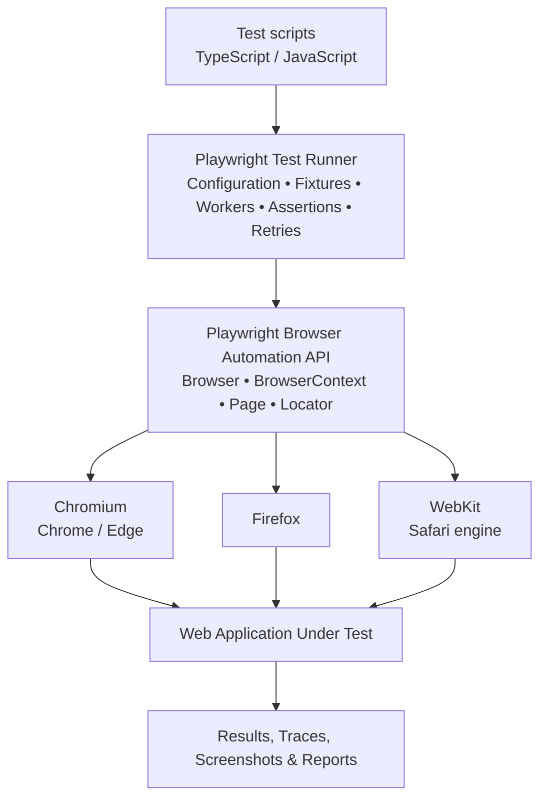

# Playwright Architecture — Official Documentation Guide

**Official website:** https://playwright.dev/

Playwright is an open-source browser automation framework developed by Microsoft. It supports end-to-end testing using Chromium, Firefox, and WebKit.

> **Note:** The following is a conceptual architecture synthesized from Playwright's official documentation, **not** an official architecture diagram reproduced from the site.

## 1. Playwright architecture diagram



**Hierarchy:** `Browser → BrowserContext → Page → Locator`

## 2. Main architecture components

| Component | Responsibility |
|---|---|
| Test scripts | Define test scenarios, interactions and expected outcomes. |
| Test runner | Runs tests and manages workers, retries, configuration and reporting. |
| Playwright API | Exposes browser automation operations. |
| Browser | Represents a browser instance using Chromium, Firefox or WebKit. |
| BrowserContext | Isolates cookies, local storage, sessions and other browser state. |
| Page | Represents a browser tab or popup. |
| Locator | Identifies and interacts with elements with auto-waiting and retry behavior. |
| Reporters | Produce results for investigation and CI workflows. |

By default, Playwright Test provides an isolated browser context and page for each test.

## 3. How a test executes

1. **Read configuration.** Playwright reads `playwright.config.ts` to determine projects, browsers and settings.
2. **Start workers.** The runner executes tests in independent worker processes; parallelism is configurable.
3. **Launch browsers.** Workers manage browser instances that can be reused across tests.
4. **Create contexts.** The `context` and `page` fixtures provide a fresh isolated environment per test.
5. **Interact with the application.** Playwright navigates, fills fields, clicks controls and makes assertions.
6. **Capture results.** Reporters, screenshots and traces support result analysis and debugging.

## 4. Example Playwright test

Create `tests/home.spec.ts`:

```typescript
import { test, expect } from '@playwright/test';

test('Verify Playwright website', async ({ page }) => {
  await page.goto('https://playwright.dev/');
  await expect(page).toHaveTitle(/Playwright/);
});
```

Run:

```bash
npx playwright test
```

## 5. Official documentation links

| Topic | Official reference |
|---|---|
| Getting started | https://playwright.dev/docs/intro |
| Browser contexts and isolation | https://playwright.dev/docs/browser-contexts |
| Pages | https://playwright.dev/docs/pages |
| Parallel workers | https://playwright.dev/docs/test-parallel |
| Fixtures | https://playwright.dev/docs/test-fixtures |
| Library versus test runner | https://playwright.dev/docs/library |
| Locators | https://playwright.dev/docs/locators |
| Trace viewer | https://playwright.dev/docs/trace-viewer |

**Source attribution:** Playwright official documentation at https://playwright.dev/ . The architecture graphic and explanatory organization above are an original synthesis for training purposes.
